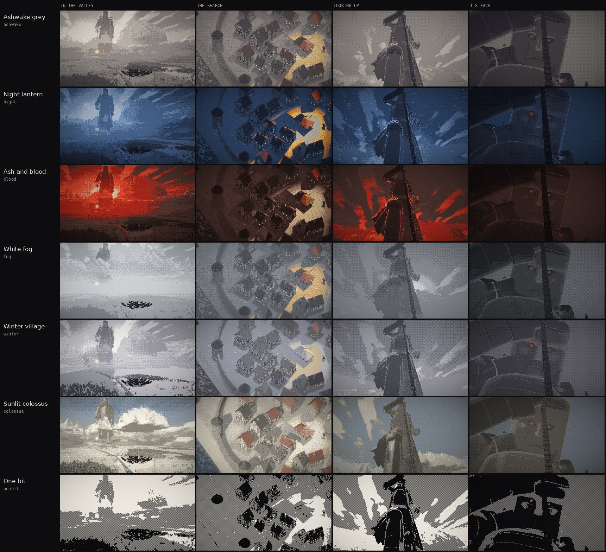

# Underfoot

Style library, Volumes 16 and 17. A small playable piece in Ashwake's grey dithered 3D at a scale far past the Warden, and the same piece under seven looks so one can be picked for the game.

You are one person in a walled hill town. Something nearly three kilometres tall walks the valley toward the town with a lantern on a chain. When it stops beside the walls it holds the lantern out over the roofs, and its light comes in low between the houses, a few steps behind you wherever you go. Every house throws a long shadow, and the shadows swing as the lantern moves. Stay in the dark until it gives up and steps over the town. If the light holds on you too long, the camera drops behind the roofs and climbs the chain to its face.

Live pages (private to your account until you share them):

- The game, Volume 16: https://claude.ai/artifact/K2hJiA7qiUtsjN6CEuXFtC
- Seven looks, Volume 17: https://claude.ai/artifact/JsG8QA65nsY2zkKMAGDh7j

Everything is drawn and synthesized in code: WebGL2, no engine, no runtime dependencies, no image or sound files in the game itself. Each built page is one HTML file of about 160 to 180 KB.

```
dist/index.html     the looks page: seven looks side by side at four moments, plus the live game with a look bar
dist/game.html      the game alone, with a look bar
dist/stills/        28 stills (7 looks x 4 moments) and their thumbnails, used by dist/index.html
src/                the source (ES modules)
page/               the templates the build wraps the code in: looks.html, game.html, and test.html for headless runs
plans/              headless shot plans: moments.json (the four comparison moments), cycle.json (one cycle)
tools/              the build, the headless screenshot tool, the per-look shots runner
docs/               looks-sheet.jpg: all seven looks at the four moments in one picture
CLAUDE.md           short notes for working on this with Claude Code
```



---

## Contents

1. [Playing it](#1-playing-it)
2. [The loop, phase by phase](#2-the-loop-phase-by-phase)
3. [The light and hiding](#3-the-light-and-hiding)
4. [The picture: Ashwake grey](#4-the-picture-ashwake-grey)
5. [The seven looks](#5-the-seven-looks)
6. [How a frame is drawn](#6-how-a-frame-is-drawn)
7. [The world](#7-the-world)
8. [The giant](#8-the-giant)
9. [Cameras](#9-cameras)
10. [Sound](#10-sound)
11. [Code map](#11-code-map)
12. [Tuning values](#12-tuning-values)
13. [Building, running and testing](#13-building-running-and-testing)
14. [Porting to Godot 4](#14-porting-to-godot-4)
15. [What went wrong on the way](#15-what-went-wrong-on-the-way)
16. [Known weak spots and next steps](#16-known-weak-spots-and-next-steps)

---

## 1. Playing it

| Action | Keyboard and mouse | Touch | Page button |
| --- | --- | --- | --- |
| Begin, skip a card, play again | Space, Enter, or a click on the picture (any key after it found you) | A tap | |
| Walk | W A S D or the arrow keys, or hold the left mouse button where you want to go | Drag anywhere on the picture (a virtual stick: the further you drag, up to 40 px, the faster) | |
| Look up at it | Hold L or the right mouse button | A second finger | Hold "Hold to look up" |
| Sound on or off | M | | "Sound" |
| Jump to a moment (`?debug` only) | | | "It comes", "It searches", "It finds you", "It passes" |
| Change the look | | | The look bar: Ashwake grey, Night, Ash and blood, Fog, Winter, Sunlit, One bit |

- The title waits for your first key or click. That gesture starts the sound (browsers need a gesture before audio), focuses the picture and begins night 1.
- Until then the town plays itself under the title: an autopilot hides well on odd cycles and walks out into the light on even ones. Once you have begun, nothing plays for you.
- **A score game of nights.** Each night the lantern searches longer, aims closer behind you, fills the eye faster and checks the lit windows sooner (`src/fall/nights.js`; past night 3 the table keeps tightening to a floor). The score is the seconds you last in its searches, banked ten at a time as they tick (a chime, the plate flashes), plus 50 for each night passed. A card after each night shows the night's seconds and the score; when it finds you, a card shows how long you lasted against your best on that night, why it got you (you stayed too long under it, it chased you down, the half light, the open, its hand, the roof it took off you), the score and your best (kept in the browser). A catch keeps the banked tens and loses only the seconds since the last. Any key starts a new run at the plant of night 1. `game.html?night=5` starts there.
- **Things that happen.** The windows go out in batches as it comes and every one is dark by the plant; after it passes they come back one by one. On night 1 one townsperson walks out with a candle to see the light and is taken; nights 2 to 4 have two bad hiders. From night 5 the town has learned: it walks in over a town already black (no window to put out, no smoke, no doors banging) and nobody is out, so there is no take; the lantern's pool is the only light. Every townsperson taken leaves a stain, so the town records the run. The lantern itself follows your trail and nothing else.
- **Deep and shallow shadow.** Inside a shadow the eye drains; at its edge (where only part of the lantern's glass is hidden) it fills slowly; in the light it fills fast. The ring under your feet is blue, dim amber or bright amber for the three, and the eye meter matches. The market hall, the church porch, the gate arches and the banks under the bridge are always deep, until night 4, when its hand starts lifting the wooden roofs (section 2); stone stays.
- The picture only runs while it is on screen and the tab is visible.
- The look can also be picked in the address: `game.html?look=night`. The last look chosen is remembered in the browser (`localStorage`, key `underfoot.look`).

HUD, top left:

- **Phase label**: Quiet, It is coming, It is here, It is looking, It is kneeling (night 2 on), It is reaching (night 3 on), It is giving up, It sees you, It has you, It is passing, Dawn.
- **The eye** (during the search): opens as it notices you. Its colour is your shadow: cold in deep shadow, dim amber in shallow, the look's accent when you are lit. When it is fully open, it has you.
- **Night N**, top right.

---

## 2. The loop, phase by phase

One night lasts about 85 to 120 seconds; a run is as many nights as you last. Times are approximate.

| Phase | Length | What happens |
| --- | --- | --- |
| **Title** | until you begin | A low camera at the east end of the town, pushing in on a 14 s loop. The giant walks toward you up the valley, left of centre. "UNDERFOOT / something is walking the valley / It takes what its light finds." Any key or click begins: a dip to black, then night 1. |
| **Calm** ("Quiet") | 2 to 11 s | Daylight. Windows lit. Birds on the roofs. The giant is about 4.7 km away. |
| **Approach** ("It is coming") | ~26 s | It walks in: one footfall every 8.5 s, each a long boom that arrives seconds late, a camera shake, dust, birds taking off, roof dust shaking down. Each boom puts out the windows nearest the boot and thins the chimney smoke; close booms bang the shutters and slam a door. Cloud slowly covers the sun (the world dims over 18 s). From the second night on, the camera cuts up to look at it coming for 6.5 s. In the last 4 s the play camera pulls out to show the boot coming down outside the west wall. |
| **Plant** ("It is here") | 3.5 s | The boot lands outside the west wall, its toe about 60 m from it. Dust ring, shake, the view holds wide, then closes back in on you. |
| **Search** ("It is looking") | 30 to 60 s | It lowers the lantern on the full length of the chain until it rides 70 m over the ground, and hunts you with it (section 3). Every second counts toward the score. Townspeople come out and are taken. It cannot end while it has you; in its last seconds, once it has lost you, the lantern lifts and the light widens. **From night 2 it kneels** as the lamp comes down: the back foot slides back and turns sole up, the knee lands where the boot stood (a second boom, deeper than the boot's, the shake, dust round the knee, roof dust, the shutters, the birds), the body settles on that thigh and bends over the town; the lantern hand is held low, so the chain is short and the lamp stops sharper. **From night 3 its left hand comes down**: about 10 s into the search (once a search on nights 3 and 4, twice from night 5, three times on night 7: a reach takes 14 s and never starts in the search's last seconds), "It is reaching", a groan of iron overhead, the shake building for 3 s, then one fingertip 22 m across lands on the open ground nearest the lamp's mark (the square's middle, a plaza, a field), a slam, dust down the lanes, the lamp swinging. Under it when it lands you are caught: black at once, the hit, the card. Where it rests for 8 s it is a wall to the light and to walking, and the lamp keeps to the side of it; then it lifts (the groan, clods) and leaves a pressed print. **From night 4 it lifts the roofs**: as the search begins (the knee down, about 4 s in) the hand comes for the market hall at the square's west end, "It is reaching", the fingertip settles on its ridge, the timber creaks, and the roof goes up with the fingertip out of the top of the picture (a crack, dust off the eaves, tiles down); the lamp's light falls in where the shade was and the posts stand bare for the run. From then on, 4 s under any wooden roof on posts (the hall, the arcade on the square's south side, the church porch) with the light on it and the hand comes for that roof too: "It is reaching" gives you 3 s to get out (the arcade's and the porch's it hooks from beside, the fingertip coming down on the open ground in front). Stone stays (the gate arches, the banks under the bridge). From night 6 the roofs go at 3 s. **From night 5 the town has learned**: it walks in over a town already black and nobody is out. |
| **Caught** ("It sees you", or "It has you" under its hand) | 9.5 s (2.4 s under its hand) | If the eye fills: the light narrows and brightens on you (1.1 s), a flash and a cut to a low camera behind the town, a slow tilt from the roofs up the chain and the legs to its face, the eyes catch fire, a push in on the face, "it sees you", a flash, a fade. Then the game-over card; any key starts a new run at the plant of night 1. |
| **Leave** ("It is passing") | 21 s | If you lasted the search: the camera cuts to the street and looks up as its boot swings over the south side of the town and lands beyond the east wall. It walks away across the picture to the south-east. The cloud lifts, the windows come back one by one (the taken stay dark), the smoke returns. Then the night card, and the next night. |

---

## 3. The light and hiding

The whole game is where the lantern's light falls and where the shadows fall. None of this changes with the look.

### The lantern

- A 40 m iron cage with eight glass panes, hanging from the giant's right hand on a chain about 1.9 km long (the chain is rebuilt every frame as alternating links between the grip and the lantern ring).
- It trails the hand on a damped spring (stiffness 0.9, damping 1.25 per second, so it lags about a second and swings a little past) and hangs straight down the chain's length. While it searches, the chain is paid out until the ring rides 70 m over the ground under it (just above the church roof; it never goes lower).
- **The beam is a spotlight.** While the giant walks, it points straight down. While it searches, the lantern is held **48 m to one side** of the spot it is lighting and the beam is aimed at that spot, so the light arrives at about 45 degrees. The side it is held on starts as "from the giant" and swings slowly round it (up to about 80 degrees either way, on two slow sines). Every house throws a long shadow, and the shadows turn as the lantern moves.
- Cone: 0.36 rad outer, 0.11 rad inner, so the pool is bright in the middle and falls off softly to its edge. Intensity 1.5, falling off as 1 / (1 + (d / 260 m)^2). Each look can draw it brighter or dimmer (`lanI`), but the hiding test always uses 1.5.
- The lantern has its own 1024 x 1024 perspective shadow map, so the houses, walls, trees and the church cast real shadows in its light.

### How it hunts you

- Your position is recorded every 0.25 s (the trail).
- The point it aims at walks your trail about **3.5 s behind you** (14 samples back), at up to **4.3 m/s**, a little slower than you run (4.6 m/s). So it is always close, but you can outrun it for a while.
- Around that point the light hunts in small loops (about 7 m, on four sines), as if it were looking.
- It walks your trail sample by sample, so it goes round the corners you went round and never cuts through a house; more than 4 m of your walking behind the trail's head it closes at up to twice its pace, so running away only buys time. Lit, or once the eye is a third open, it comes along your path half a second behind you at the night's hunt speed, always a little under yours, so a corner can lose it; half seen, or just after it has lost you, it goes to the last place it saw you and waits there for the trail.
- Its head turns to look where its light falls; when it has you, it looks at you.

### Hiding

- The hiding test traces three lines from your head (1.6 m up) to three points across the lantern's glass (its centre and about 13 m to either side). Each line is checked against every house, wall and tower as an oriented box with its roof as a prism.
- How lit you are = cone factor x intensity x falloff x (lines that get through / 3). So a shadow's edge is a soft band where you are half seen, and the pool's middle is more dangerous than its edge.
- **The eye meter**: while lit it fills at (0.08 + 0.17 x light) per second, 20% faster while you run. In the dark it empties at 0.3 per second. Full means caught. In the middle of the pool that is about 3 seconds; at its edge, much longer.
- The best places: tight against the far side of a house from the lantern, in the angle of two houses, under the market hall. They stop being safe when the lantern swings round, so watch the shadows turn and move with them.
- From night 3 its fingertip, while it rests on the ground, is a wall to the light, with one difference: it stands next to the lamp, so its shadow is sharp (a house's is drawn with a soft band because a house is far from the lamp), and the rule follows the picture: under the fingertip's shadow the centre line alone decides, and you are deep. The lamp's target keeps off the fingertip. It only ever lands where the ground is open at least 9.5 m round the tip's centre (`HAND_FIT`), so it never comes down on someone against a wall; it comes down on whoever stands in the open within 9 m of the spot (about where the iron meets the ground).
- From night 4 a wooden roof on posts is no shelter for long: with the light's mark within 20 m of you under it for the night's `roof` seconds (4, 3 from night 6), its hand comes for the roof. The roof is its own piece (`ROOFS` in world.js, drawn each frame by `roofPiece` in mesh.js), and the cover and the roof's occluder carry it: a couple of metres up they stop counting, so the rule and the picture open together, and the fingertip never comes down on the bare posts (`clearance` still counts the cover). Under a roof it will lift, the peer gives way to the roof going. Caught within 12 s of the roof over you going, without having lost the light between, the card says "It took the roof off you."
- You crouch automatically when you stand still in the dark.

---

## 4. The picture: Ashwake grey

This is the default look (`ashwake` in `looks.js`) and the one Volume 16 was made in. The other six looks change the colours and the light but keep the same pipeline, so this section describes how every look works.

The style is Ashwake's (Volume 13, "Grey, Dark & Jewel") made bigger: a dithered, nearly grey picture seen from high and far away, where only a few things carry colour. Here they are the lantern's light, the tile roofs, the lit windows, the cloak, and the embers in its eyes.

### Resolution and output

- The scene is drawn at **386 x 218** pixels (384 x 216 shown, a 1-pixel border so the camera can slide by fractions of a pixel without the edges showing).
- It is scaled up with hard pixels to the canvas (up to 2x device pixel ratio). Post effects and the UI run at canvas resolution, sampling the low-res image.

### The palette: 28 colours

Every pixel ends up as one of these:

| Ramp | Colours (dark to light) |
| --- | --- |
| Greys (8) | `#0f0e10` `#1f1d20` `#34313a` `#4d494c` `#6b6667` `#8e8884` `#b5aea6` `#dfd9cf` |
| Amber (5) | `#2a2118` `#4b3b29` `#725b3d` `#9f8151` `#cfaa69` |
| Moss (5) | `#1d231c` `#303a2c` `#4a5741` `#6a7757` `#8f9a74` |
| Slate (5) | `#1a2028` `#2d3542` `#465161` `#697482` `#919ba7` |
| Rust (5) | `#281917` `#442824` `#653e34` `#88584a` `#ab7966` |

How a pixel picks its colour (`FS_QUANT` in `shaders.js`):

1. The scene is lit in full colour and tone-mapped (`1 - exp(-colour x exposure)`, then a square root as gamma) into an 8-bit buffer.
2. Glows (the lantern in the air, the eyes when they burn), sun shafts and bloom are added here, before the snap. Glows are soft screen-space blobs that a depth check dims when something stands in front of them.
3. Brightness is the usual luma, put through the look's tone curve: `pow(Y, gamma)`, then contrast round 0.5, then lift (Ashwake grey: gamma 1, contrast 1.05, lift 0). Colour is measured as chroma: the length of (blue - luma, red - luma).
4. If chroma is above a threshold that is itself dithered between the look's `chroma` pair (Ashwake grey: 0.05 and 0.14, scaled down in the darks), the pixel takes the hue ramp whose direction is closest to its own. Otherwise it takes the grey ramp.
5. Inside a ramp, the two nearest steps are dithered with a 4 x 4 Bayer matrix, but only near the boundary between them (the middle half of each band is flat). So large areas are flat colour and only the edges between bands break up into a pattern. This is what keeps it looking like Ashwake rather than noise. (Two other dither modes exist for other looks; section 5.)

### Post (`FS_POST`)

- **Tilt-shift**: outside a horizontal band through the middle, a 12-tap rotated Poisson blur of up to 1.7 low-res pixels. Only on the play camera (it fades out as the camera zooms out), never on the cinematic cameras. Each look scales it (`tilt`).
- **Flash and fade** for cuts and the catch.
- **UI** drawn on a 384 x 216 canvas in Wisp, the pixel font made for Ashwake, in the look's UI colours.
- **Grain** (4.5% here) and a soft **vignette** (0.4 here), both per look.

### Light through a cycle

| | Sun | Sky light | Ground bounce | Fog colour | Exposure |
| --- | --- | --- | --- | --- | --- |
| Calm | full (warm, low in the west) | full | full | full | 1.2 |
| Search (overcast) | 20% | 75% | 40% | 64% | x 1.22 |

The "dim" amount rises over the approach and falls in the second half of the leave. Each look has its own dim factors (`dimK`). Upward faces stay relatively bright under the overcast (sky light from above), so pale streets keep their contrast against dark roofs and iron.

---

## 5. The seven looks

A look changes only the picture: palette, light, fog, sky, particles and post. The hunt, the cameras, the timing and the hiding test are the same under every look. `src/fall/looks.js` holds them as plain objects (`LOOKS`, in page order `LOOK_ORDER`), `game.setLook(name)` switches at run time, and the look bars on both pages call it.

| Id | Name | Palette | Light and sky | For this game | The risk |
| --- | --- | --- | --- | --- | --- |
| `ashwake` | Ashwake grey | 8 warm greys; amber, moss, slate, rust | a low warm sun in the west | the lantern is the one strong colour in the hunt | the middle of the road; calm and search look alike until the cloud comes |
| `night` | Night lantern | 8 blue-blacks; amber, moss, moon blue, rust | a cold moon low in the west, stars, a big moon disc, windows never below 40% lit, light bloom | the clearest read: amber means seen, blue means hidden | lighter than a real night, so it stays playable; blue night is a common look |
| `blood` | Ash and blood | warm blacks to bone; blood, ember, olive, steel | a huge low red sun behind the giant, dark ash falling, a bone-white lantern | the most dread; the red sky makes its outline read from the street | red tires the eye; the look closest to Bloodborne and Berserk |
| `fog` | White fog | cool greys to white; four muted ramps | a dense low fog (1/900 per metre at the ground, 220 m scale height), no sun disc, a brighter lantern | the fog hides the scale until it is close | far shots go nearly empty; looking up is grey on grey |
| `winter` | Winter village | cold greys to snow white; red, amber, ice, pine | bright cold light, snow on every upward face (the giant's shoulders too), snowfall | the cleanest town; snow on its armour makes it old and still | lamplight on snow is pale on pale; snow feels cosy |
| `colossus` | Sunlit colossus | bleached greys; sage, sand, sky, terracotta | a high sun in the south, blue sky, bloom, more grain, less tilt-shift, a lighter overcast | the most epic giant | in daylight the lantern is a faint pool, so hiding barely reads |
| `onebit` | One bit | black and paper | flat grey fill light so dark sides still read, a white lantern, no grain or tilt-shift | light is paper and shadow is ink: the plainest read of the mechanic | the face breaks into black shapes; the town loses detail |

### What a look holds

| Field | What it does |
| --- | --- |
| `name`, `short`, `note` | its name, a short label, a one-line description |
| `light.sun` | the sun's (or moon's) direction; the town's sun shadows follow it |
| `light.sunCol`, `skyCol`, `gndCol` | sun, sky and ground-bounce light colours (linear, before exposure) |
| `light.fogCol`, `fogSunCol` | fog colour away from and toward the sun; the horizon uses them too |
| `light.fogA`, `fogB` | fog density at the ground (per metre) and its falloff with height (1 / scale height) |
| `light.exposure` | exposure before the tone map |
| `light.lanCol` | the lantern's colour: its light, its glass and its screen halo |
| `dimK` | how much each light falls when the cloud comes (`sun`, `sky`, `gnd`, `fog`, `fogSun`; 1 = all of it) and how much exposure rises (`exp`) |
| `palette.greys`, `palette.hues` | 2 to 8 neutral steps, and 0 to 4 ramps of 5 steps each, dark to light |
| `chroma` | `[lo, hi]`: how coloured a pixel must be to leave the greys (dithered between the two) |
| `contrast`, `lift`, `gamma` | the tone curve before the snap: `pow(Y, gamma)`, contrast round 0.5, then lift |
| `dither` | 0 = flat inside a band, dithered at its edges (Ashwake's rule); 1 = ordered 8 x 8 all the way; 2 = three flat levels (ink, a 50% checker, paper) |
| `bloom` | glow round bright pixels (14 taps on a spiral, above a 0.6 knee) |
| `stars`, `sunSize`, `sunDisc` | star field (one pixel per star at any lens), sun or moon disc size and brightness |
| `snow` | snow on upward faces: ground, buildings, the giant (not people, glass, flame or eyes) |
| `ash` | `{ amount, lum, fall }`: how many particles, how bright, how fast they fall (Winter uses them as snowfall) |
| `grain`, `vignette`, `tilt` | post: grain amount, vignette strength, tilt-shift multiplier |
| `winMin` | the least share of windows left lit (Night keeps 40%) |
| `lanI` | the lantern's drawn brightness, relative to 1.5 (the hiding test never sees it) |
| `cloudCov` | added to the cloud cover |
| `ui` | HUD colours: `text`, `dim`, `accent`, `title`, `sub`, `plate`, `edge` |

### How the comparison was made

The four moments are the same frames of the same run in every look. The game's random numbers come from one seeded generator, the test page boots held (`?hold`) so its own frame loop never advances time before the script does, and each look gets a fresh page. `plans/moments.json` steps it:

1. **In the valley**: the title camera after 50 updates of 0.05 s.
2. **The search**: `force('search')`, then 160 updates with the eye meter held at a quarter so it never catches you.
3. **Looking up**: the look-up button held for 50 more updates.
4. **Its face**: `force('caught')`, then 160 updates, when the face shot has settled.

Frames are captured at 1152 x 648 (three times the game's 384 x 216). `npm run shots` reproduces them pixel for pixel. The page's stills are those frames as WebP (`dist/stills/<look>-<moment>.webp`, and 576 x 324 thumbnails in `dist/stills/t/`).

### Adding a look

1. Copy an entry in `LOOKS` in `src/fall/looks.js`, give it a new id, and add the id to `LOOK_ORDER`.
2. Add a button with `data-look="<id>"` to the look bars in `page/looks.html` and `page/game.html`.
3. For the comparison page, add a row (`article.look#look-<id>`, copying an existing one), run `npm run shots -- <id>`, and save the four PNGs from `out/shots/<id>/` as WebP into `dist/stills/` (1152 x 648) and `dist/stills/t/` (576 x 324) under the names the row uses.

---

## 6. How a frame is drawn

`renderer.js`, `render(scene)`. In order:

1. **Town sun shadow map** (2048 x 2048, orthographic, aimed along the sun, texel-snapped so it does not shimmer, sized to what the camera sees): only when the camera is zoomed in (half-height under 260 m). Terrain near ring, houses, the per-frame mesh (which carries the wooden roofs on posts, so a roof its hand is lifting still throws its shadow).
2. **Wide sun shadow map** (2048 x 2048 over 10.4 km or more): the terrain's middle and far rings and the giant (skinned in its own depth shader). Sampled with 8 rotated Poisson taps, so the giant's shadow is soft.
3. **Lantern shadow map** (1024 x 1024, perspective from the lantern along its beam).
4. **The scene at 386 x 218**, in colour:
   - the **sky** (a gradient from fog colour at the horizon to a darker dome, a bright glow round the sun, the sun's disc at the look's size, stars when the look has them, and long bands of high cloud),
   - **terrain** (three rings of grid, frustum-culled per chunk),
   - **the town and props** (static mesh, culled per 32 m chunk),
   - **the per-frame mesh** (chain, lantern, mill sails, you),
   - **the giant** (GPU-skinned),
   - **dust** (dithered billboards; their alpha is compared against the Bayer value, so no blending is needed),
   - **birds** (tiny flapping billboards),
   - **ash** (single-pixel points drifting in a box round the camera target; inside the lantern's cone they glow, which shows the beam in the air; brightness and fall speed per look).
5. **Clouds** (`FS_CLOUDS`, only when the camera is zoomed out): a slab of cumulus from 820 m to about 1.9 km, raymarched per pixel up to the scene's depth. 40 steps find the surface, 5 bisection steps refine it, then it is shaded as a solid: a normal from the density gradient, two taps toward the sun for self-shadow, sky and ground light. The march starts at least 650 m from the camera, so a cloud is never in the camera's face. The town sits under a gap.
6. **Palette pass** (`FS_QUANT`): glows, sun shafts, bloom, the tone curve, the snap to the look's palette.
7. **Post** at canvas size.

The palette pass takes fixed-size arrays: 8 greys and 4 ramps of 5. `buildPalette()` in `renderer.js` pads a shorter palette and passes how many entries are real (`uNGrey`, `uNHue`); `setPalette()` swaps it.

### Lighting in the scene shader (`FS_MESH`)

- Sun: Lambert x shadow (town map and wide map, the darker wins) x cloud shadow (the cloud coverage looked up where the sun ray crosses 1250 m).
- Sky light: a blend from ground colour (facing down) to sky colour (facing up), plus extra sky toward the low sun.
- Lantern: a spotlight with its cone, falloff and shadow map, in the look's lantern colour. Its glass glows in that colour as a gradient from a hot core, scaled so its peak tone-maps to about 0.75 and stays inside the hue ramp; the panes are dithered away by half so the flame shows through. The palette pass adds a halo round it and marches toward it the way it does toward the sun, so a cone of light hangs under it in the air.
- Iron: sun and lantern specular highlights, and a reflection of the sky that grows toward grazing angles (fresnel), so plate edges and upturned plates catch light.
- The giant only: a rim light on its silhouette when backlit by the sun, and the lantern as a point light from below (no shadow map), so the forearm, the chest and the face go amber while it searches. Its eyes are always embers and brighten as the eye meter fills.
- Snow (when the look has it): albedo blended to snow white on faces pointing up.
- Emission (windows, glass, flame, eyes).
- **Height fog**, integrated along the ray from a start point near the target (not from the eye, which is 1.5 km away in play), so distance and height both thin it.
- A **see-through hole** round you: anything between the camera and you within a small screen radius is dithered away (the lantern and its chain get a hole seven times larger, and the chain thins out higher up the screen), so nothing hides you from yourself.

### Noise and level of detail

Shaders use a 256 x 256 tiling noise texture with three channels at different cell counts (32, 64 and 128 per tile). Helpers take the cell size in metres (`N1`, `N2`, `N3`). Each fragment knows how many metres a pixel covers (from screen-space derivatives), and detail finer than about a pixel fades to its average (`lodF`, `N2L`, `N3L`), so cobbles, furrows, rivets and seams show up close and do not sparkle far away.

---

## 7. The world

`world.js` holds the layout (pure functions and data), `mesh.js` builds geometry from it, `textures.js` bakes two ground maps.

- **Units**: metres, y up. The play camera looks toward -x -z, so -x is the top left of the screen and +x +z comes toward you. The giant arrives from -x, with the low sun behind it.
- **Terrain**: a height function: slow valley swells, a hill under the town, a rise for the windmill, a ring of ridged-noise mountains starting about 3 km out, and a river channel round the south of the town with flat banks. Drawn as three rings of grid: 2 m spacing out to 256 m, 16 m to 2.3 km, 96 m to 9.2 km, with a skirt under the near ring.
- **The town**: drawn by hand as a text map (`src/fall/townmap.js`, one character per 2 m cell, read by `src/fall/town.js`) on a hill inside a wall ellipse 148 x 132 m: a square with the market hall, two covered stalls, the well and an arcade along its south side; a west yard with a big tree inside the west gate; an east green with a chapel and a ruin; a church whose tower and porch face the square; a tower house in a walled courtyard; 73 houses of one to three storeys along doglegged lanes, with gable or hip roofs in dark shingle, slate or dull rust tile, chimneys, jetties; stairs and terrace walls on the south slope; gatehouses, 8 towers and 44 wall segments. Farmsteads outside, a windmill whose sails turn, a stone bridge where the east road crosses the river, about 2,600 trees. UNDERFOOT_NIGHT_DESIGN.md section 10 has the map and the legend.
- **Ground maps** baked once at start: a near map (1 m texels over the square 512 m round the town: streets, ambient occlusion round walls, roads, water) and a far map (36 m texels over 18 km: roads, forest, farmland, water).
- **Terrain shading**: pale dust near the town, dry grey grass, cobbles with gaps up close, roads, rock on steep ground and in the mountains, snow on the peaks, a river with a sky reflection, and the giant's **footprints** (crushed dark ground with a raised rim, the last six kept).
- **Fields**: furlongs, blocks about 320 m across with a hedge round them, each ploughed in long strips (8 to 17 m wide) in one direction. A furlong keeps to one or two crops (stubble, pasture, ploughed, fallow, green), with ridge-and-furrow lines and grass balks between strips. They read as farmland from far away and do not look like paving next to the town.
- **Collision**: a 0.5 m grid of blocked cells (houses, walls, low walls, towers, posts, trees, well, water). You slide along walls.
- **Occluders** for the hiding test: every house as an oriented box plus a roof prism, plus walls, low walls, towers, the church, the chapel, the ruin's walls, the tree crowns inside the walls, and the roofs on posts (hall, stalls, arcade, porch) above their eaves only.

---

## 8. The giant

### Size

About **2.9 km** tall in its rest pose (the top of the helm at 2,938 m, the comb a little higher). Pelvis at 1,350 m. Thigh 632 m, shin 603 m, upper arm 521 m, forearm 481 m. Each boot is about 460 m long and 190 m wide. The town would fit on one boot.

### The mesh (`giant.js`, `buildGiantMesh`)

Built in a rest pose (facing +z, its left at +x) as flat-shaded surfaces (`surface()` builds a grid, gives each triangle its own face normal so the armour reads as plates in the dithered palette, and fixes each triangle's winding so the outside is front-facing; the face mask keeps averaged normals because its relief is shaded by the shader). Lofts and shells use 12 to 20 segments: about **13,500 triangles**. Each vertex stores two bone indices and a blend weight.

- **Cuirass**: a lofted barrel with a ridge down the front; three belly lames; a gorget.
- **Helm**: a rounded skull, a domed top, a thin comb from front to back.
- **The face**: a sculpted iron mask over the front of the helm, about 310 m from chin to brow (see below).
- **Mail aventail**: a curtain of mail from the helm's lower edge to the shoulders, round the back and sides like a hood.
- **Pauldrons**: a great shell and one lame over each shoulder, and a standing flange by the neck (a haute-piece).
- **Arms**: rerebrace, a round couter at the elbow, vambrace, a flared cuff. The right gauntlet's fingers close round the chain; the left hand is open.
- **Faulds and tassets** over the hips.
- **Legs**: cuisses and greaves with a keel ridge down the front, poleyns with side wings at the knees.
- **Sabatons**: eight overlapping lames from heel to toe with a ridge along the top, a toe cap, a closed heel, a flat sole.
- **Cloak**: a ragged cloak down the back from under the pauldrons to about 430 m off the ground, with folds and a torn hem.
- **Woods**: small trees growing on the pauldrons.

### The face

`maskZ(x, y)` gives the mask's depth at a rest-pose point: a rounded base just in front of the skull, the brow rolling back into it and the chin turning under, plus the features from `maskRelief(u, v)`, each a gaussian bump or dip in face coordinates (u across, v up from the chin):

- a heavy brow ridge, drawn down in the middle (a frown), with a crease between the brows,
- deep sockets, slanted up at the outer corners, 40 m deep,
- a long straight nose, widening to its tip, with nostrils,
- high cheekbones over gaunt hollows,
- folds from the wings of the nose to the corners of the mouth,
- a thin closed mouth turned down at the corners,
- a square chin.

The same function is written again in GLSL. The face shader uses it to darken the hollows and brighten the ridges, so the face reads even when it is backlit and dark. An ember sits deep in each socket (it brightens as it sees you), and rust runs down from the eyes like tears.

### Materials (`FS_MESH`)

- **Iron** (body and helm): near black, plate seams every 104 m with a lit lip, rust bleeding down from each seam, moss on upward faces above 300 m. On the boots: lames with rivet heads along their back edges, and dried mud up to 30 to 100 m, with splashes higher up.
- **Face**: paler iron, shaded by its relief, embers, rust tears, a dark line between the lips.
- **Mail**: rows of small rings, dark, catching light in points.
- **Cloak**: heavy faded red-brown cloth, darker streaks down the folds, moss where it faces up, dust along the hem.
- All of this is computed from the rest-pose position, so it rides the body as it moves.

### Skinning and the pose (`createGiant`)

15 bones: pelvis, chest, head; thigh, shin, foot for each leg; upper arm, forearm, hand for each arm. The pose is computed on the CPU each frame and uploaded as 15 matrices; the vertex shader blends two bones per vertex.

`pose()`:

1. **Feet** come from the step plan (below): position, yaw and toe pitch.
2. **Pelvis** between the feet, as high as both legs can reach (so a leg never stretches). Kneeling (`G.kneel`, from night 2), the director places it over the kneeling knee instead (`G.pelvisAt`) and drops it so the thigh stands on the knee; the knee cap blends off so both knees may fold.
3. **Chest**: a forward lean and a twist. Reaching (`G.reach`, from night 3), the chest also turns half a radian toward its left hand, which brings that shoulder low enough for the fingertip to touch the square.
4. **Head**: either a fixed pitch, or turned toward a look target. The look is limited like a neck: yaw within 1 radian and pitch between 0.3 up and 1.25 down, measured in the chest's frame.
5. **Legs**: two-bone IK from hip to ankle, bending toward the foot's facing.
6. **Arms**: two-bone IK toward a hand target. While it searches, the right hand's target is moved so that the **grip** (175 m past the wrist, where the chain is held) is over the spot where the lantern should hang. The left hand points (one finger straight, three curled back, every tip capped); when it reaches, the wrist is moved in six relaxed steps so that the **fingertip** (`FINGER_L`, 265 m past the wrist) lands where the director asks, within a metre.
7. Useful world points are kept (`W`): neck, head, eyes, knees, ankles, toes, heels, hands, grip, the left fingertip and elbow, shoulders, chest.

### Walking

A step plan is a list of plants: which foot, where, which way it faces, and when it lands. `footAt(plan, foot, t)` returns where a foot is at time t: still on its last plant, or in a 7.2 s swing toward the next one, along an arc that lifts 180 m plus 16% of the step length (about 440 m for a 1.6 km step), with the toe pitched down as it lifts and up as it lands. Plants come every 8.5 s. The walk in is planned from 4.7 km out to a fixed stance beside the town (front foot about 400 m from the west wall). The walk out steps over the south side of the town and goes off to the south-east.

Each landing is a footfall (boom, shake, dust ring, footprint, roof dust and birds when it is close). Each lift throws clods of earth and plays a metal groan.

---

## 9. Cameras

| Camera | Where | Notes |
| --- | --- | --- |
| **Play** | 1,500 m away, 45 degrees round, 48 degrees down, looking at you | A perspective camera with a field of about 1.7 to 2.3 degrees: it reads as orthographic, like Ashwake's. Its target snaps to whole low-res pixels and the leftover fraction slides the picture in post, so edges never swim. Near plane 500 m. Follows you with a smoothing of about 0.3 s. During the search it widens by 15%. |
| **Plant** | the play camera, widened 6.6x and moved west | Pulls out 4 s before the boot lands, holds on the dust, closes back in. |
| **Look up** | over the roofs, 240 to 270 m from you on the far side from the giant, 100 to 110 m up, aimed at its chest | A cut through a 0.3 s dip to dark, both ways, then a slow 3 s push in. |
| **Catch** | first the play camera pushing in on you; then a cut to 300 m behind the town, 45 m up | The second shot starts on the roofs and the lantern and tilts (spherically) up the chain and the body to the face, then narrows from 54 to 11 degrees on the face. |
| **Leave** | in the street, 37 m from you, 16 m up | Follows the swinging boot overhead, then its landing. |
| **Title** | low over the east end of the town | A slow push toward the giant walking up the valley. |

All the real cameras (everything but play) use a 2 m near plane, and a guard pushes the camera out of the giant's legs and boots if it ever ends up inside them (capsules from heel to toe, ankle to knee and knee to pelvis).

---

## 10. Sound

`sound.js`. All synthesized with WebAudio, through a gentle compressor. The same under every look.

| Sound | How it is made |
| --- | --- |
| Wind | looped white noise through a low-pass whose cutoff wanders (an LFO at 0.06 Hz), louder as the cloud comes in |
| Whistle | the same noise through a narrow band-pass wandering round 1.15 kHz, only when it is windy |
| Footfall | a sine falling from 46 to 24 Hz over 3 s, a second from 70 to 34 Hz, and 4.5 s of brown-noise rumble through a falling low-pass. Close by (under 1.6 km) also a crack and the rattle of roofs (short band-passed noise bursts). Louder and brighter when close. **Delayed by distance at 343 m/s** (up to 5 s): you see the dust before you hear it. |
| Lift | a sawtooth groan sliding from 36 to 29 Hz with a 3 Hz wobble, through a band-pass at 170 Hz, and earth falling (low-passed noise), also delayed by distance |
| Lantern | a low roar of fire (brown noise through a low-pass and a peak at 140 Hz), louder as the lantern comes close |
| Chain | a pair of short noise bursts through very narrow band-passes (a metallic ring) every 0.25 to 1.4 s while the lantern is near, more often while it moves, panned to where it is |
| Drone | three detuned triangle waves (55, 73.4 and 110 Hz) through a low-pass, breathing slowly, under the search |
| Birds | a flutter of short band-passed bursts when they take off |
| Caught | a slow horn: four sawtooths (41, 55, 55 and 82 Hz, a little out of tune) through a low-pass that opens from 140 Hz to 1.1 kHz over 6 s while it swells |
| Hit | at the final flash: a deep thump (62 to 26 Hz) and a burst of noise |

---

## 11. Code map

### `src/main.js`
Boots both pages; anything a page lacks is skipped. Fills the palette strips and chips, wires the contact sheet's large view (click a still; arrow keys step through looks and moments), the look bar, "Play this look", the current look's note and palette swatch, "Hold to look up", "Sound" and "Jump to". Picks the first look from `?look=`, then the remembered one, then `ashwake`. Creates the game, runs the frame loop (only while the canvas is on screen and the tab is visible), and exposes `window.__v16` for tests. `?hold` starts it paused; `?nointro` skips the title.

### `src/fall/looks.js`
The seven looks (`LOOKS`) and their page order (`LOOK_ORDER`). Plain data; section 5 lists the fields.

### `src/fall/game.js`
The piece itself. `createGame(canvas, opts)` (`opts.look`, `opts.noIntro`) returns `{ R, G, S, snd, LOOKS, LOOK_ORDER, look, setLook(name), frame(dt), update(dt), render(), force(name), view(name) }`.

- Constants: the stance, step timing, cut timing, lantern size, height, side offset and trail lag. The light comes from the current look.
- `walkPlan`, `startCycle`, `leavePlan`: the step plans.
- Input: keys, mouse (walk toward the cursor), touch (a drag stick), right button for looking up.
- The lantern: `lanLight` (position, beam direction, cone), `isLit` (the three-ray hiding test), `stepLantern` (the spring and the hang).
- `footfall`, `lifted`: dust, clods, shakes, prints, birds, sounds.
- `kneeFall`, `kneelAmount`: the kneel from night 2. `landingSpot`, `updateHand`, `landHand`, `liftHand`, `liftFinger`, `endHand`: the hand from night 3 (the night table's `hand`): the reach, the fingertip as an occluder and a blocker (`world.js` `blockDisc`, `clearance`), the crush (`S.crush`, the card line "Its hand came down on you."), the print. `roofGrab`, `startRoof`, `gripRoof`, `tearRoof`, `roofOff`, `restoreRoof`: the roofs from night 4 (the table's `roof`): the hall's at the search's start, then the roof you have stood under too long (`S.roofDwell`), the roof rising with the fingertip (`ROOFS[i].dx, dy, dz, tilt`), the cover and occluder off, the card line "It took the roof off you." (`S.roofOffT`). From night 5 (`DARK_NIGHT`) `startNight` sets the town dark and the booms bang no shutters.
- `updateGiant`: the walk, the search pose, the kneel, the hunt (trail, aim, lock-on), where the lantern is held, the hand, the head's look, the chain length.
- `autopilot`, `updatePlayer`: walking, collision, the eye meter.
- `updateStory`: phases, windows, dimming, flashes and fades, the eyes.
- Cameras: `playCam`, `lookEye`, `tiltEye`, `introEye`, the dip cuts, `keepOut`.
- `dimmed(k)`: the current look's light under k of overcast. `render()`: hands the look's settings to the renderer.
- `drawUI`: the HUD in Wisp, in the look's UI colours; `glows`: screen glows for the lantern and the eyes.

### `src/fall/renderer.js`
`createRenderer(canvas, giantMesh)`. Owns every GPU resource and draws one frame from a plain `scene` object (camera, light, giant bones, lantern, windows, footprints, fade, flash, birds, ash, glows, UI, and the look's palette pass, sky and post settings). `buildPalette()` and `setPalette()` for the look's palette, `project()` from world to screen, `puff()` to spawn dust.

### `src/fall/shaders.js`
All GLSL: mesh and skinned vertex shaders, depth shaders, the shared noise and fog code, the cloud density, the scene shader with every material and the snow, the sky with stars and the sized sun disc, the clouds, dust, ash, birds, the palette pass (three dither modes, bloom, tone curve) and post.

### `src/fall/giant.js`
The giant's rest joints, the mesh builder, the face function, the pose solver (two-bone IK, head look limits), and `footAt` for step plans.

### `src/fall/townmap.js` and `src/fall/town.js`
The town as a text map (one character per 2 m cell, a legend at the top of the file), and the reader that turns it into rectangles: houses with their fronts, lanes, plazas, the hall, stalls, arcades, the church with its tower and porch, chapels, ruins, trees, bushes, low walls, stairs, the wall traced into segments with its towers and gates, and the street field for the ground map.

### `src/fall/world.js`
The valley, the river, the roads, the farms, the woods, the bridge and the mill; the town from town.js with the ground put under it; collision, occluders, the covers and `segmentBlocked` for the hiding test.

### `src/fall/mesh.js`
Material ids (`M`), geometry helpers (triangles, quads, boxes, cylinders in a local frame), and builders for every kind of building and prop. `buildWorld()` packs the town into 32 m chunks with bounding boxes; `buildTerrain()` builds the three rings; `millSails()` adds the turning sails to the per-frame mesh.

### `src/fall/props.js`
Per-frame geometry: `chain()` (alternating links along a sagging curve), `lantern()` (cage, glass, cap, basin, flame, ring), `person()` (you: legs, coat, arms, hood, scarf, walking and crouching).

### `src/fall/textures.js`
The tiling noise texture and the two baked ground maps.

### `src/fall/sound.js`
`createSound()`: everything in section 10.

### `src/lib/`
`gl.js` (WebGL2 context, shader programs with uniform setters, textures, framebuffers, canvas fitting), `mat4.js` (lookAt, ortho, multiply), `noise.js` (seeded random, value noise, fbm), `wisp.js` (the Wisp pixel font: glyphs and drawing).

### `page/looks.html`
The Volume 17 page: the contact sheet (seven rows of four stills, each with its palette strip, what it is, what it does for the game and its risk), "Which fits this game", the live game with the look bar, and the large view. The build puts the bundled script where it says `__SCRIPT__`.

### `page/game.html`
The Volume 16 page with a look bar: the game, buttons, keys, notes and the current look's palette.

### `page/test.html`
A bare 1152 x 648 page for headless runs.

### `plans/`
`moments.json`: the four comparison moments (section 5). `cycle.json`: eight frames across one cycle (the title, calm, the approach, the plant, the search, the catch twice, the leave), with the HUD on.

### `tools/`
`build.mjs` (esbuild bundle into a template), `shot.mjs` (Playwright: load a built page in headless Chromium, run a plan, take screenshots; serves files next to the page), `moments.mjs` (runs `moments.json` for each look into `out/shots/<look>/`).

---

## 12. Tuning values

| Value | Where | What it does |
| --- | --- | --- |
| `STEP_T = 8.5` s | game.js | time between footfalls |
| `SWING = 7.2` s | game.js | how long a foot is in the air |
| `STANCE` | game.js | where the feet stop beside the town |
| `LAN = 40` m | game.js | lantern size |
| `LAN_Y = 70` m | game.js | how high the lantern ring rides over the ground while searching |
| `LAN_OFF = 48` m | game.js | how far to the side of the lit spot the lantern is held (the beam angle) |
| `lag` 25 / 16 / 16 | nights.js | how many 0.25 s trail samples behind you it aims on nights 1 / 2 / 3 (floor 12 later), walked one by one (`S.trailI`) |
| `hand` 0 / 0 / 20, `roof` 0 / 0 / 0 | nights.js | seconds between reaches of its hand (2 less a night from 4, floor 12); seconds under a wooden roof with the light on it before it comes for the roof (4 from night 4, 3 from night 6) |
| `DARK_NIGHT = 5` | nights.js | from this night the town is black before it comes and nobody is out (`people` 0) |
| `ROOF_GRIP = 0.8`, `ROOF_LIFT = 3.0` s | game.js | how long the fingertip rests on a roof, and how long the roof takes to rise out of the picture to the hand's rest |
| `walk` / `hunt` 3.6 / 4.2, 3.9 / 4.3, 4.0 / 4.4 m/s | nights.js | how fast its mark follows your trail / comes along your path once it has seen you, by night; never faster than that (you walk 4.6) |
| 0.08 + 0.17 x light, -0.3 | game.js, `updatePlayer` | how fast the eye fills when lit and empties in the dark |
| 4.6 m/s | game.js, `updatePlayer` | your running speed |
| cone 0.36 / 0.11 rad, I = 1.5 | game.js, `lanLight` | beam width, soft edge, brightness (the hiding test uses these) |
| `light` | looks.js, per look | sun, sky, ground, fog colours, fog density, exposure, lantern colour |
| `dimK` | looks.js, per look | how dark the overcast gets |
| `palette`, `chroma` | looks.js, per look | the colours, and how coloured a pixel must be to leave the greys |
| `contrast`, `lift`, `gamma`, `dither`, `bloom` | looks.js, per look | the palette pass |
| `grain`, `vignette`, `tilt`, `lanI`, `winMin` | looks.js, per look | post, the lantern's drawn brightness, the windows left lit |
| hh 26 m, x1.15 in search | game.js, `playCam` | play camera half-height (zoom) |
| `DIP_OUT = 0.12`, `DIP_IN = 0.2` s | game.js | the dip on a camera cut |
| `CUT1 = 1.1` s | game.js | when the catch cuts from you to the town |
| tilt radius 1.7 px | shaders.js, `FS_POST` | tilt-shift blur strength (times the look's `tilt`) |
| `REST`, `THIGH`... | giant.js | the giant's proportions |
| `maskRelief` | giant.js and shaders.js | the face (change both together) |

---

## 13. Building, running and testing

Requires Node 18 or newer.

```bash
npm install                        # esbuild for the build; Playwright only for the screenshot tools
npx playwright install chromium    # once, only for the screenshot tools
npm run build                      # dist/index.html (the looks page) and dist/game.html (the game alone)
npm run build:test                 # out/test.html: unminified bare page for headless runs
npm run shots                      # the four moments for every look -> out/shots/<look>/
npm run shots -- night blood       # ...or only some looks
npm run shots:cycle                # eight frames across one cycle -> out/cycle/
```

Open `dist/game.html` or `dist/index.html` directly in a browser (from the disk is fine). `dist/index.html` needs `dist/stills/` next to it. Address options: `?look=<id>`, `?night=<n>` (start on that night), `?debug` (the jump buttons), `?nointro` (skip the title), `?hold` (start paused, for scripts).

### The itch.io build

```bash
npm run build:itch                 # itch/index.html: the game alone, Night look, no picker (page/itch.html + src/itch.js)
npm run zip:itch                   # builds, then itch/underfoot-itch.zip with index.html at the zip root
```

Before building, put your name in `AUTHOR` at the top of `src/itch.js` (it is "by ____" until then); it shows on the title and small on the game-over card. The page has its own doctype, charset and viewport, a full-bleed 16:9 screen, Sound and Fullscreen buttons, and a hold-to-look button on touch screens. The loop is capped at 60 Hz; the sound stops while the tab is hidden or the frames stop coming; a lost graphics context or a frame error shows a message instead of a frozen picture.

On itch.io: create the project with Kind of project **HTML**, upload `itch/underfoot-itch.zip` and tick **This file will be played in the browser**. Embed options: **Embed in page**, viewport **960 x 540** (the picture is 960 x 540 on large screens and 480 x 270 on small ones, so that viewport shows it pixel for pixel; the page snaps to a whole multiple whenever one fills most of the window), **Fullscreen button** on, **Automatically start on page load** off (the title waits for a click, which is also what starts the sound), **Mobile friendly** only after a phone test. Tags that fit: stealth, horror, pixel-art, short, browser.

Headless screenshots run in Chromium with SwiftShader, so they are slow: simulate many updates and render once. A plan is a list of steps (`eval`, `wait` in ms, `shot` of an element, `full` page), given as a file or inline:

```bash
VW=1152 VH=648 node tools/shot.mjs out/test.html out/search '[
  {"eval": "const g = __v16.game; __v16.force(\"search\"); for (let i = 0; i < 100; i++) g.update(0.05); g.render();"},
  {"shot": "search", "sel": "canvas"}
]'
```

The page is served with `?hold` unless `QUERY` says otherwise (`QUERY='?look=night&hold'`). Files next to the page are served too, so `dist/index.html` shows its stills.

The test API on `window.__v16`:

| | |
| --- | --- |
| `hold = true` | stop the frame loop, so steps are under your control |
| `game.update(dt)`, `game.render()` | advance and draw one frame |
| `force(name)` | jump to `calm`, `approach`, `plant`, `search`, `caught` or `leave` |
| `setLook(name)` | switch the look (also updates the page's look bar and notes) |
| `view(name)` | fixed cameras for checking the look: `town`, `foot`, `foot2`, `foot3`, `up`, `up3`, `w1`-`w3`, `face`, `wide`, `intro`, `look`, `st1`-`st3`, `hero`, `hero2`, `valley`; `view(null)` to go back; the camera moves on the next `update` |
| `game.S.noUI = true` | hide the HUD (clean frames) |
| `game.S`, `game.G`, `game.R` | the state, the giant, the renderer |
| `game.look`, `game.LOOKS` | the current look's id, all looks |
| `errors` | any errors caught |

---

## 14. Porting to Godot 4

The ideas map cleanly; most of the work is the look.

1. **The low-res picture.** Render the 3D world into a `SubViewport` at 386 x 218 with nearest filtering, shown on a `TextureRect` (stretch, keep aspect) or through a `CanvasLayer`. For the sub-pixel slide, render 2 pixels larger and offset the rect by the camera's leftover fraction.
2. **The camera.** A `Camera3D` either in orthographic mode (size about 43 m) or perspective with a 2 degree field 1.5 km away. Snap its target to whole low-res pixels in camera space.
3. **The palette.** A full-screen shader on the viewport texture (a `ShaderMaterial` on the `TextureRect`, or a `CompositorEffect`): copy `FS_QUANT` almost as is. Pass the look's colours, their luma and the hue directions as uniforms. Do the tone mapping yourself (set the environment's tonemap to Linear) so the snap sees the same values.
4. **Looks.** One `Resource` per look holding the palette (as uniforms, a ramp texture or a 3D lookup), the environment (sun, ambient, fog density and height), the lantern colour and the post settings. Swap the Resource at run time and leave gameplay alone.
5. **Lights.** A `DirectionalLight3D` for the sun with shadows (PSSM 2 splits is plenty), its energy driven by the dim amount; an ambient/sky light that falls with it. The lantern is a `SpotLight3D` with shadows enabled, angle about 20 degrees, attenuation tuned to section 3, aimed each frame from the lantern at the lit spot.
6. **The giant.** Export the mesh from `buildGiantMesh()` (positions, normals, two bone ids and a weight per vertex) into an `ArrayMesh` with `ARRAY_BONES` and `ARRAY_WEIGHTS`, under a `Skeleton3D` with the 15 bones from `REST`. Drive the bones from GDScript with the same `pose()` logic (two-bone IK is a few lines; `SkeletonIK3D` also works). Port `footAt` and the step plans as they are.
7. **Materials.** A `ShaderMaterial` per material family. Pass the rest-pose position as a custom vertex attribute (`CUSTOM0`) so the seams, rust, mud and the face's relief ride the body, exactly as `vT` does here.
8. **The hiding test.** `PhysicsDirectSpaceState3D.intersect_ray` from your head to three points on the lantern, against static bodies on the houses (box shapes plus a convex roof). Same cone and falloff maths for how lit you are.
9. **Fog and clouds.** Godot's height fog in `Environment` gets close; the cloud slab is easiest as a full-screen pass that reads depth, as here.
10. **Sound.** Pre-render the synthesized sounds to samples, or generate them at run time with `AudioStreamGenerator`. Keep the distance delay: play footfalls with a timer of distance / 343 seconds.

---

## 15. What went wrong on the way

The game (Volume 16):

- The first giant was a hooded pilgrim in a robe. It read as a doll or an egg. Replaced by an armoured colossus.
- The armoured giant read as a toy robot until it got plate seams, keel ridges, a cloak and a face.
- A crown of iron spikes and a flat helm with a slit looked weird rather than frightening. Replaced by the sculpted mask. A bronze version read as a cartoon gold mask, so it is pale iron now.
- The camera saw through its feet: after stepping over the town the giant walked straight through the play camera's line of sight, and the boots were open at the heel. It now leaves across the picture, the heels are closed, the soles are muddy, and real cameras are kept out of the legs.
- The catch camera interpolated between camera positions and swooped through fields and under the ground. Replaced by a cut and a tilt; looking up became a cut too.
- The lantern first hung on a real 36-second pendulum and barely moved, lit straight down (so shadows were short), and searched random spots. Now it is a stiff spring, held to one side so shadows are long, and it follows your trail.
- Fields made of Voronoi cells looked like paving stones next to the town. Now furlongs of long strips.
- Wide shots were washed out by fog and a pale sky. Now a darker dome, darker fog and sun shafts.
- Clouds appeared in the camera's face when the camera was inside the cloud layer. The march now starts 650 m out.

The looks (Volume 17):

- The same plan gave different frames under different looks: the page's own frame loop ran a few real-time frames before the script took over. Pages now boot held with `?hold`, and each look gets a fresh page.
- Ash and blood came out orange-red edge to edge. Darker sky and fog now, red only near the sun and on the giant's rim.
- White fog hid the giant completely in the valley shot. A thinner, lower layer shows its head and shoulders above the bank.
- Sunlit colossus faced the sun and came out a sepia haze. The sun moved high to the south, so the giant is side-lit against blue sky.
- One bit with a full 8 x 8 dither turned every mid-tone into the same grey checker; a tone curve then washed the giant out of the sky. Three flat levels and more fill light fixed both.
- Stars drawn per sky cell became big white squares in the narrow face shot. Now one pixel each at any lens.
- The lantern's halo and glass stayed amber under a bone-white lantern. Both now take the look's lantern colour.

---

## 16. Known weak spots and next steps

The game:

- The town is small in the catch shot and the title shot.
- The lit ground is a strong yellow in Ashwake grey. It is the one warm colour, but a softer falloff or a dimmer lantern might sit better.
- Up close the plate armour still reads a little like a robot.
- The sound has not been checked by ear (levels were measured offline).
- Tested in a software renderer only, not on a real graphics card or a phone. Two 2048 x 2048 shadow maps and a 1024 x 1024 one every frame may be heavy on weak phones; halve them first if it stutters.
- Next places to hide: cellars, the church nave, under the bridge, the market hall made walk-under. A second giant on the horizon would sell the scale further.

The looks:

- Sunlit colossus works against the game: in daylight the lantern barely reads. Its ground also reads as snow at small sizes.
- Night lantern is lighter than a real night so it stays playable.
- One bit breaks the face into black shapes and loses the town's detail.
- White fog's far shots are nearly empty.
- Each look was tuned on the four comparison moments. The approach, the plant and the leave were not checked under every look.
- Next: pick one. The looks could also change along the cycle (grey or sunlit while it walks the valley, night or red once it stops over the town). The overcast amount `S.dim` already exists to drive that: the light and fog can blend, and the palette would switch at a dip to dark, since palettes do not blend cleanly.
